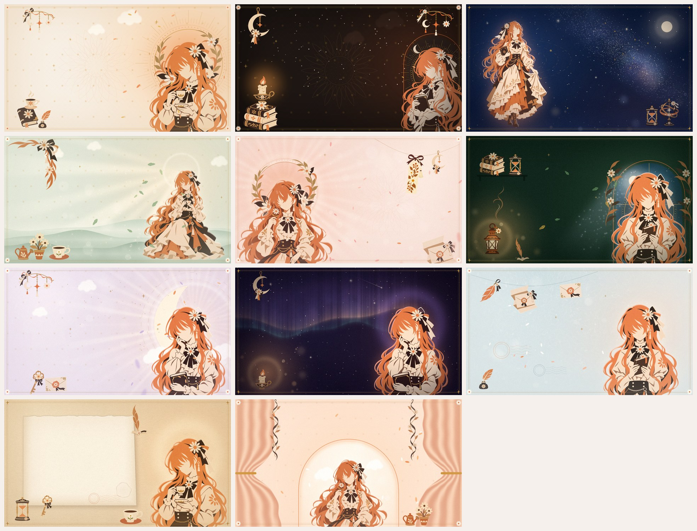

# claudecode-golden-hour · 金色黄昏

A warm-orange theme and animated backdrop for Claude Code.
Claude Code 的暖橙配色主题，带一张会动的背景画。

- 配色：白天是奶油色纸面配暖橙，晚上是暖炭色配橙光
- 背景（桌面端和手机端）：深色拱窗里抱书回望的小克，夕阳光环、暖云、星月流苏挂饰、书堆和烛台、飘落的花瓣和闪烁的星星
- 系统开了"减少动态效果"时，背景会停在静态画面

## 安装 / Install

在终端里的 Claude Code 会话中输入：

```
/plugin install claudecode-golden-hour --marketplace qq13113013831-web/claudecode-golden-hour
```

问 `Add marketplace?` 时输入 `y`，然后按回车选用户范围（user scope）。

或者在命令行里：

```
claude plugin install claudecode-golden-hour --marketplace qq13113013831-web/claudecode-golden-hour
```

桌面端里 `/plugin` 不能用：点输入框旁边的 **+**，选 **Plugins**，**Add marketplace** 填 `qq13113013831-web/claudecode-golden-hour`，再 **Add plugin**。

装好后新开一个会话就能看到。

## 已知问题

桌面端每帧都会给背景计时，3 秒平均超过约 5.5ms 就会把背景永久定格成静态，直到重新打开会话。
这个版本已经把元素数量压到原来的三分之一左右，正常情况下在 4ms 上下。电脑特别忙的时候（编译、渲染、开很多窗口）仍然可能触发，重新打开会话就会恢复。

## PPT 模板 / Slide templates

`ppt-templates/` 文件夹里有 11 张 16:9 的 PPT 背景图，1920×1080 PNG，没有文字，可以直接当幻灯片背景，或者当桌面壁纸。
主角都是小克，留白都在人物旁边，标题和正文可以直接压在空白处。

11 slide backgrounds (16:9, 1920×1080 PNG, no text) in `ppt-templates/`.



| 编号 | 名字 | 色调 |
| --- | --- | --- |
| 01 | 昼 · 午后茶歇 | 浅色 |
| 02 | 夜 · 月窗 | 深色 |
| 03 | 深海 · 观星 | 深色 |
| 04 | 灰青 · 晨雾茶歇 | 浅色 |
| 05 | 豆沙粉 · 花信 | 浅色 |
| 06 | 墨绿 · 书房 | 深色 |
| 08 | 雾紫 · 月下托腮 | 浅色 |
| 13 | 午夜 · 极光 | 深色 |
| 14 | 海盐 · 信笺 | 浅色 |
| 15 | 牛皮纸 · 复古书桌 | 浅色 |
| 16 | 蜜桃 · 窗台 | 浅色 |

用法：在 PowerPoint 或 Keynote 里把图片设成幻灯片背景（PowerPoint：设计 → 设置背景格式 → 图片或纹理填充 → 插入），再加文本框就行。

只想要图的话，不用装插件，在 GitHub 上点开 `ppt-templates/` 里的图片下载即可。

这些图片以 [CC BY-NC 4.0](ppt-templates/LICENSE) 发布：可以免费使用和修改，需要署名，不能商用。

## 致谢与许可

- 背景里的人物和挂饰立绘由 GPT 绘制，再描成矢量（`hooks/art.js`）
- `hooks/make-colors.js` 是 Claude Code 的 mod 开发技能自带的配色辅助文件，按原样附带，不属于下面的 MIT 许可
- PPT 模板里的人物和小物件剪影由 GPT 绘制，背景和光效用 Python 代码画出再合成
- `ppt-templates/` 里的图片以 CC BY-NC 4.0 发布，见 [ppt-templates/LICENSE](ppt-templates/LICENSE)
- 其余代码以 MIT 许可发布，见 [LICENSE](LICENSE)
